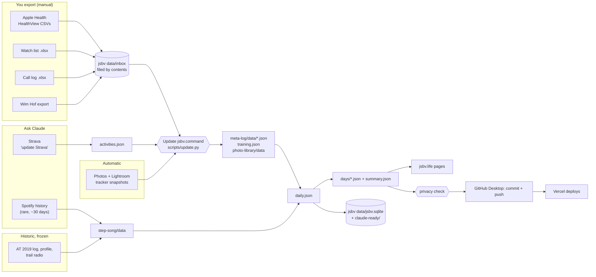

# Updating jsbv.life's data

**Normal routine (weekly or whenever):**
1. Drop any fresh export into `~/Documents/00-Database/jsbv data/inbox`, with any name. Update recognises each file by what is inside it and files it (table below). Files it doesn't recognise stay in the inbox and are listed at the end.
2. Double-click **`Update jsbv.command`** in the repo folder. Or run `python3 scripts/update.py`; `--check` shows what would run, `--all` rebuilds everything, `--only watch,daily` rebuilds just those.
3. Commit and push in GitHub Desktop. Vercel publishes in about a minute.

What runs, in what order and from which files, comes from `scripts/config/registry.json` (each row's `run`). A source is skipped when none of its files, its builder or `scripts/lib/` changed since its last good run; the PCT//PREP, SKY//LOG, daily, seasons, report card and BODY//MAP builds also run once a day, since they count from today. Last good runs: `meta-log/data/private/update-state.json` (git-ignored). Then the Claude-ready copy (`jsbv data/claude-ready/`, public data only), the store (`jsbv data/jsbv.sqlite`: every dataset by day and by category, sealed ones and the private IRON//LOG tables included, with a `columns` table saying which columns may leave the Mac; built by `build_store.py`, never committed), `manifest.json`, and the privacy check (`scripts/check_public.py`), which looks at every file git would commit for phone numbers, emails, IPs, raw-export fields, call-log names and private datasets in plain form. A problem there means: don't commit until it's fixed. Last comes a freshness table: `!!` marks a stale source, with the steps to fix it under the table. If a source fails, the site keeps that source's last good data.

**The inbox files:** Health export folders → `raw/health/`; AT&T usage workbooks (Talk, Text and Data sheets) → `ATT/raw/ATT-usage-<date>.xlsx`; call-log backups → `raw/calls/`; Wim Hof exports → `raw/breath/`; water CSVs → `raw/water/`; watch list → `raw/watch/`; smoking workbook → `raw/smoking/`; Epic PDF + season calendar → `raw/fortnite/`; Spotify zip → `raw/spotify/`; `Timeline-*.xlsx` → the data folder. Nothing is overwritten (a taken name gets `-2`); every move is logged in `jsbv data/raw/inbox-log.csv`. Recognising a file reads only its sheet names and header row.

**Shared code:** `scripts/lib/` holds what builders share: `paths.py` (where things live, `write_json`), `finders.py` (finding exports), `xlsx.py` (the one workbook reader: it decodes only the sheets and columns a builder names), `inbox.py`, `privacy.py`, `moon.py`, `store.py` (SQL-first datasets write their tables into `jsbv data/jsbv.sqlite` with it; `scripts/export_public.py` makes their JSON from the registry row's `run.export`, public columns only, and refuses a private column).

**SQL-first rule (Nov 23, 2026):** every new dataset is SQL-first. Older builders still write JSON and move over one at a time, whenever one is next changed. `sql_first: true` in the registry marks the ones that have moved.

## Sources

| Source | Kind | Raw file (outside the repo) | How to refresh | Builder → repo file |
|---|---|---|---|---|
| Apple Health (steps, distance, flights, exercise, HR, HRV, sleep) | manual export | `jsbv data/health export YYYY-MM-DD/` (HealthView hourly CSVs) | iPhone → HealthView → export hourly CSVs from Jan 1 to today → AirDrop → drop the folder in the inbox | `build_health_log.py` → `meta-log/data/health.json`; also feeds `build_pct_training.py` |
| Watch list | manual (you log it) | `jsbv data/YYYY-Watch-List.xlsx` | Log titles, save. Update first runs `fill_posters.py`: OMDb posters / IMDb ids / ratings for new titles go to `jsbv data/omdb-cache.json` (key in `omdb-key.txt`; misses listed in `posters-to-check.csv`: add the IMDb ID in the Titles sheet) | `build_watch_log.py` → `watch.json`, `watch-titles.json` |
| Scorecard | ask Claude: "pull my scorecard" | Screening Scorecard (private claude.ai page) → Claude saves `jsbv data/scorecard.json` (scores, propaganda meter, notes, custom scales, surprise actors) | Claude writes the file; Update rebuilds | `build_scorecard.py` → `watch-scores.json` (joined onto the `#watched` wall by IMDb id, then title) |
| Call log | manual export | `jsbv data/YYYY-MM-Call-Log-Backup.xlsx` | Save a fresh backup from the call-log app → inbox | `build_call_log.py` → `calls.json` |
| Phone (AT&T) | manual export | `jsbv data/ATT/raw/ATT-usage-<from>_to_<to>.xlsx` (one per bill; myAT&T → Usage → download usage details; overlapping copies are fine) | Drop the download in the inbox | `build_phone.py` → `phone/data/phone.json` + `meta-log/data/phone.json` (aliases only); private key + tables in `jsbv data/ATT/` |
| Breathwork | manual export | `jsbv data/export_results.numbers` (or `.csv`) | Wim Hof app → export results → inbox | `build_breath_log.py` → `breath.json` |
| Water | manual (you log it) | `jsbv data/YYYY-MM-Water-Log.csv` (date, time, fill_ml; note column never read). Every file matching `*Water-Log*.csv` is read | Drop a new month's log in the inbox | `build_water_log.py` → `water.json` |
| Smoking | manual (you log it) | `jsbv data/2026-fall-smoking.xlsx` (Log tab: Year, Month, Day, Time hhmm, Type) | Type new rows, save | `build_smoking_log.py` → `private/smoking.json` (git-ignored) → sealed into `private.enc.json` (needs `pip3 install cryptography` and the key file) |
| Timelines | manual (you log it) | `jsbv data/Timeline-*.xlsx` (listed in `scripts/config/timelines.json`) | Edit and save. New place names need a row in `scripts/config/places.json` | `build_timelines.py` → `meta-log/data/timelines.json` |
| Fortnite | manual export, per season | `jsbv data/YYYY-MM-DD-jsbv-fortnite-data.pdf` + `Fortnite-Library-Manager.numbers` | epicgames.com → Account → Privacy → request your data; update the season calendar. Needs `pip3 install pypdf numbers-parser` | `build_fortnite.py` → `games/data/fortnite.json` |
| Strava hikes | ask Claude | (Strava itself) | Tell Claude **"update Strava"**: it adds new hikes (titles and numbers only) to `pct-training/data/activities.json` | `build_pct_training.py` → `training.json` |
| Training plan | hand-edited | `pct-training/data/plan.json` (original) and `plan-adjusted.json` (second plan; the page has an Original / Adjusted / Projected toggle; Projected is recomputed from the log on every build) | Edit, or ask Claude | `build_pct_training.py` |
| Photos + Lightroom | automatic | Photos library, Lightroom catalog | Nothing to do: Update runs `photo_snapshot.py` and `lightroom_snapshot.py` in `~/Documents/01-Projects/photo-library-tracker` | → `photo-library/data/*.json` |
| Fitness logs (IRON//LOG) | done (2015-2024) | `jsbv data/MetaData.dot.xlsx`, `jsbv data/The Journey of 1000lbs Begins with a Single Rep.xlsx`, `jsbv data/Training_.xlsx`, `jsbv data/Whiteboard-Workout-Log-2025.json` (ask Claude to "pull the whiteboard sheet" after editing the Sheet), `jsbv data/Gym-Notes-2022-23.json` ("pull the gym notes sheet"), `jsbv data/Gym-Notebooks.json` ("pull the notebooks sheet") | Edit a workbook and save it in "jsbv data"; Update rebuilds | `build_fitness.py` → `fitness/data/fitness.json` + `meta-log/data/lifting.json` (day dataset for the explorer / correlation matrix) (+ private `meta-log/data/private/fitness.sqlite`) |
| Spotify (STEP//SONG, music) | rare, slow | `~/Documents/01-Projects/JSBV-Step-Song/JSBV-Spotify-Data-*` | Request "Extended streaming history" at spotify.com/account/privacy (it can take ~30 days), then ask Claude to rebuild STEP//SONG | `build_step_song.py` → `step-song/data/*`, then `build_eras.py` → `step-song/data/eras.json` |
| Life chapters, hand metrics | hand-edited | `meta-log/data/life.json`, `manual.json` | Edit the JSON (format is in each file) | read by `build_meta_log.py` |
| Natal chart + sky (SKY//LOG) | automatic | `JSBV meta/text.txt` (Astro-Seek copy text; git-ignored, stays local) | Nothing: Update recomputes transits, eclipses, retrogrades and lunar phases (2015-2027) every run. New natal text: replace the file | `build_astro.py` → `meta-log/data/astro.json` (+ the `astro` and `moon` day datasets in daily.json) |
| AT 2019 log, AT breakdown, trail radio | historic | trail-log workbook, Spotify 2019 | Never; rebuild only if a builder changes | `build_at_log.py`, `build_at_breakdown.py`, `build_trail_radio.py` |

`build_meta_log.py` builds `meta-log/data/daily.json` from the repo files above (never from raw exports), then cuts the copies the pages read: one file per dataset in `meta-log/data/days/` (with a version hash in `days/index.json`) and `summary.json` for Home (`build_daily_web.py`). The Python builders read `daily.json` itself.

The workbooks can still sit in the repo folder (they're git-ignored), but `jsbv data` keeps them all in one place. Files with "copy" in the name are ignored. Exports are looked for in `jsbv data`, one folder down, and each `raw/<source>/` folder.

## Flow

## Notes
- If macOS refuses to open `Update jsbv.command` the first time, right-click it → Open.
- To run it by itself every morning at 6 and whenever a file lands in the inbox: `bash scripts/launchd/install.sh` (once; `--remove` undoes it). Give python3 Full Disk Access when the log at `~/Library/Logs/jsbv-update.log` says "Operation not permitted". The agent never commits or pushes; it ends with a notification.
- The script's "Changed files" list shows which data moved. Only those files need committing.
- Rebuilding STEP//SONG (the decade of Spotify plus steps) is a separate, heavier job. Its `END` date is set in `build_step_song.py`. Ask Claude to do it when a new Spotify export arrives. Afterwards run `python3 scripts/build_eras.py` (Lab > Musical eras).
