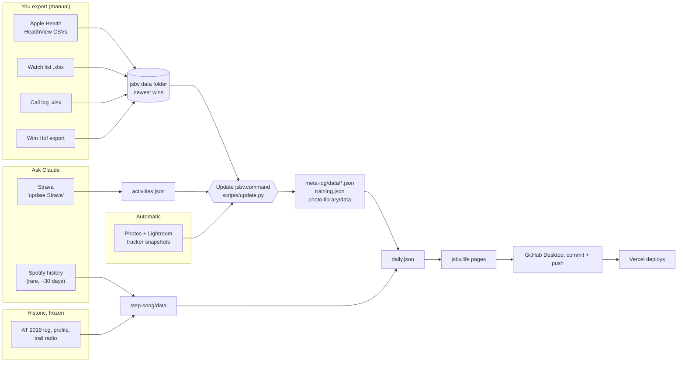

# Updating jsbv.life's data

**Normal routine (weekly or whenever):**
1. Drop any fresh exports into `~/Documents/00-Database/jsbv data` (table below). Newer files win, so old ones can stay.
2. Double-click **`Update jsbv.command`** in the repo folder. Or run `python3 scripts/update.py`; add `--check` to only see what's stale.
3. Commit and push in GitHub Desktop. Vercel publishes in about a minute.

The script rebuilds every source it finds, then rebuilds PCT//PREP and `daily.json`. It ends with a freshness table: `!!` marks a stale source, and the steps to fix it are printed under the table. If a source fails, the site keeps that source's last good data.

## Sources

| Source | Kind | Raw file (outside the repo) | How to refresh | Builder → repo file |
|---|---|---|---|---|
| Apple Health (steps, distance, flights, exercise, HR, HRV, sleep) | manual export | `jsbv data/health export YYYY-MM-DD/` (HealthView hourly CSVs) | iPhone → HealthView → export hourly CSVs from Jan 1 to today → AirDrop → name the folder by date | `build_health_log.py` → `meta-log/data/health.json`; also feeds `build_pct_training.py` |
| Watch list | manual (you log it) | `jsbv data/YYYY-Watch-List.xlsx` | Log titles, save | `build_watch_log.py` → `watch.json`, `watch-titles.json` |
| Call log | manual export | `jsbv data/YYYY-MM-Call-Log-Backup.xlsx` | Save a fresh backup from the call-log app | `build_call_log.py` → `calls.json` |
| Breathwork | manual export | `jsbv data/export_results.numbers` (or `.csv`) | Wim Hof app → export results | `build_breath_log.py` → `breath.json` |
| Smoking | manual (you log it) | `jsbv data/2026-fall-smoking.xlsx` (Log tab: Year, Month, Day, Time hhmm, Type) | Type new rows, save | `build_smoking_log.py` → `smoking.json` |
| Fortnite | manual export, per season | `jsbv data/YYYY-MM-DD-jsbv-fortnite-data.pdf` + `Fortnite-Library-Manager.numbers` | epicgames.com → Account → Privacy → request your data; update the season calendar. Needs `pip3 install pypdf numbers-parser` | `build_fortnite.py` → `games/data/fortnite.json` |
| Strava hikes | ask Claude | (Strava itself) | Tell Claude **"update Strava"**: it adds new hikes (titles and numbers only) to `pct-training/data/activities.json` | `build_pct_training.py` → `training.json` |
| Training plan | hand-edited | `pct-training/data/plan.json` | Edit, or ask Claude to sync it from the training sheet | `build_pct_training.py` |
| Photos + Lightroom | automatic | Photos library, Lightroom catalog | Nothing to do: Update runs `photo_snapshot.py` and `lightroom_snapshot.py` in `~/Documents/01-Projects/photo-library-tracker` | → `photo-library/data/*.json` |
| Spotify (STEP//SONG, music) | rare, slow | `~/Documents/01-Projects/JSBV-Step-Song/JSBV-Spotify-Data-*` | Request "Extended streaming history" at spotify.com/account/privacy (it can take ~30 days), then ask Claude to rebuild STEP//SONG | `build_step_song.py` → `step-song/data/*` |
| Life chapters, hand metrics | hand-edited | `meta-log/data/life.json`, `manual.json` | Edit the JSON (format is in each file) | read by `build_meta_log.py` |
| AT 2019 log, AT breakdown, trail radio | historic | trail-log workbook, Spotify 2019 | Never; rebuild only if a builder changes | `build_at_log.py`, `build_at_breakdown.py`, `build_trail_radio.py` |

Every page reads `meta-log/data/daily.json`, which `build_meta_log.py` builds from the repo files above. It never reads raw exports.

The workbooks can still sit in the repo folder (they're git-ignored), but `jsbv data` keeps them all in one place. Files with "copy" in the name are ignored.

## Flow

## Notes
- If macOS refuses to open `Update jsbv.command` the first time, right-click it → Open.
- The script's "Changed files" list shows which data moved. Only those files need committing.
- Rebuilding STEP//SONG (the decade of Spotify plus steps) is a separate, heavier job. Its `END` date is set in `build_step_song.py`. Ask Claude to do it when a new Spotify export arrives.
